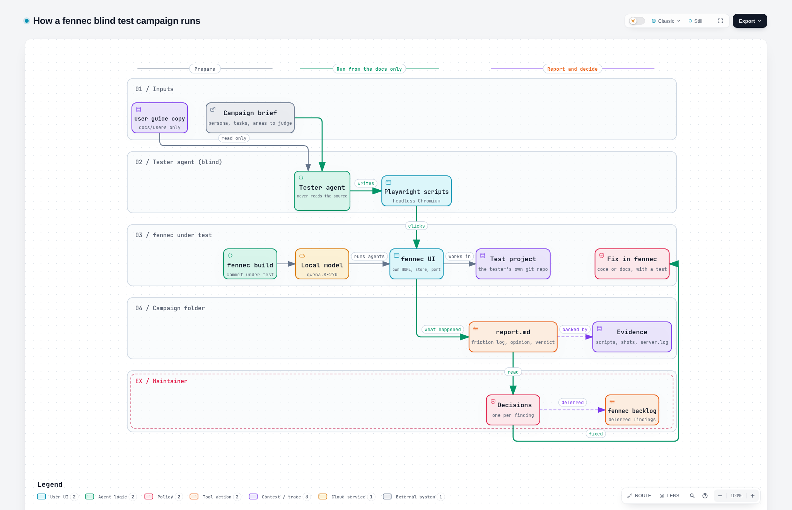

# fennec blind tests

Blind usability tests of [fennec](https://github.com/ikarys/fennec), the local tool where a human
frames the work, AI agents run it, and nothing is integrated without the human's decision.

A blind test checks what fennec's documentation promises against what a newcomer actually gets.
An agent receives **only the user guide** (`docs/users`) and a running fennec, never the source
code, the developer docs or the tests. It follows the guide on a project of its own, drives the UI
like a person would, and writes down everything that broke, confused it or worked. fennec's
maintainer then decides what happens to each finding.

These reports live here, outside fennec's repository, because each campaign carries megabytes of
screenshots and scripts that fennec's history does not need.

## How a campaign runs

Interactive version: [`diagram/campaign.html`](diagram/campaign.html) (open it in a browser).
Source: [`diagram/campaign.workflow.json`](diagram/campaign.workflow.json), drawn with
[Archify](https://github.com/tt-a1i/archify).

1. **Prepare.** The user guide is copied to a folder of its own, so the tester cannot wander into
   the source tree. A brief sets the persona, the tasks and the areas to judge. fennec is built
   from the commit under test and connected to a local model (qwen3.8-27b).
2. **Run.** The tester agent (Claude Sonnet) starts its own fennec instance (own `HOME`, store and
   port), creates its own small git project, and follows the guide page by page. It drives the UI
   only through Playwright scripts in headless Chromium, never through the API, and screenshots
   each step.
3. **Report.** It writes `report.md` and copies its scripts, screenshots and the server log next
   to it as evidence.
4. **Decide.** The maintainer reads the report and records one decision per finding: `fixed`
   (with the fennec commit or test that proves it), `deferred` (a backlog idea in fennec) or
   `no change` (with the reason). Reports are never rewritten afterwards; only the decisions table
   is filled in.

## What is in a campaign folder

| Path | What it holds |
|---|---|
| `report.md` | Front matter (date, fennec commit, kind, tester model, scope, verdict), then: the brief and how blindness was enforced, what was not covered; (a) the friction log; (b) effort per step or opinion per area; (c) what was simple; (d) the doc pages wrong or missing; (e) the verdict; (f) the maintainer's decisions. |
| `scripts/` | The Playwright scripts the tester wrote, numbered in the order it ran them. They show exactly what it clicked. |
| `shots/` | The screenshots it took; the report cites them by name. |
| `server.log` | The only runtime output the tester was allowed to read. |

Finding severities: **BLOCKER** (cannot go on), **DOC-WRONG** (the guide says something false),
**DOC-MISSING** (the guide leaves out a step you need), **FRICTION** (it works but costs time or
trust), **NOTE** (worth knowing).

## Campaigns

| Date | fennec commit | Campaign | What it covers | Verdict | Open findings |
|---|---|---|---|---|---|
| 2026-11-12 | be2723c9 | [User guide](2026-11-12-user-guide/report.md) | Every page of the guide in order: connect a model, first session, chat, workflows, plans, files, understanding, tasks, plugins, insight, settings | pass with friction | 0 |
| 2026-11-12 | be2723c9 | [Critical review](2026-11-12-critical-review/report.md) | A sceptical senior developer's scored opinion on security, plan validation, reports, questions, integration and workflows, across feature, bug fix, refactor, vague and adversarial tasks | trust the gate, not yet the numbers around it | 14 |
| 2026-11-12 | be2723c9 | Night mode (running) | Tasks board to night queue to morning report and review | | |

## Run a new campaign

Give a tester agent (the `vibecoding-blind-test` agent of the
[Vibecoding Convention](https://github.com/ikarys/vibecoding-convention)) a brief that states the
product, the persona, the tasks, the allowed services and the report path, and enforce:

- only a copy of `docs/users` is readable; no fennec source, developer docs or tests;
- no direct API calls: the UI through Playwright only;
- its own fennec instance (`HOME`, `FENNEC_DB`, port) and its own test project;
- any breach of these rules is disclosed in the report's brief.

Add the folder `<date>-<campaign>/` and a row in the table above, then fill the decisions.

Maintainer: Ikarys <bikarys@proton.me>
